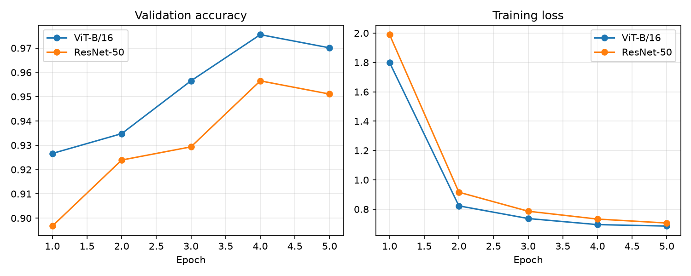
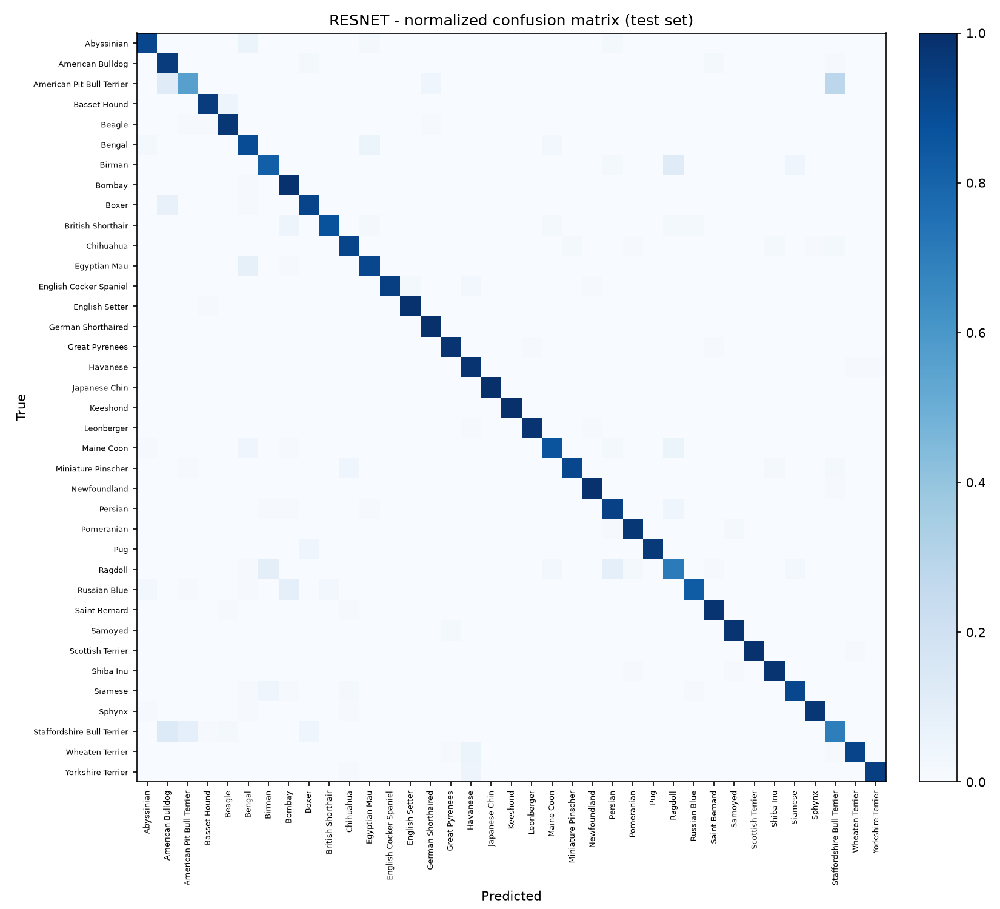
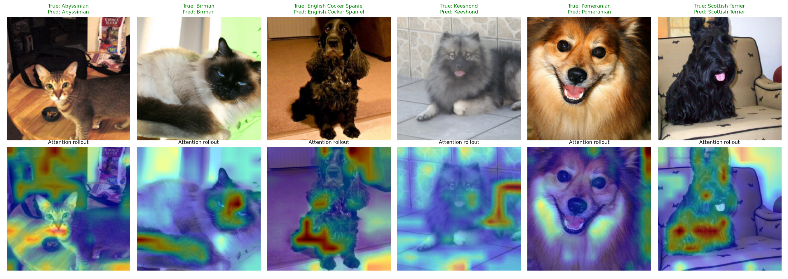

# Vision Transformer vs. CNN: Pet Breed Classification

Fine-tuning a pretrained **Vision Transformer (ViT-B/16)** and a **ResNet-50** baseline on the
[Oxford-IIIT Pet dataset](https://www.robots.ox.ac.uk/~vgg/data/pets/) (37 cat and dog breeds), then comparing them on
accuracy, per-class errors and what the ViT attends to. Built with PyTorch and torchvision.

## Results

Evaluated once on the official held-out test split (3,669 images, 37 classes). Both models used the same data split,
augmentation and number of epochs.

| Metric | ViT-B/16 | ResNet-50 |
|---|---|---|
| **Test accuracy** | **93.73%** (3,439 / 3,669) | 92.07% (3,378 / 3,669) |
| **Test macro-F1** | **0.9362** | 0.9194 |
| Parameters | 85.8M | 23.6M |
| Training time (5 epochs) | 387 s | 370 s |

ViT-B/16 was **1.66 percentage points** more accurate (61 more test images correct) while having 3.6x more parameters.
Training time was within about 5% of ResNet-50's (as logged by `train.py`; timings depend on hardware).



## Key findings

**1. ViT was consistently ahead.** Its validation accuracy was higher at all 5 epochs, both models peaked at epoch 4
(97.55% vs 95.65% on a 368-image validation split), and ViT beat or tied ResNet on 33 of the 37 breeds by per-class F1
(better on 25, tied on 8, lower on 4; F1 values are rounded to two decimals in the reports). Its largest per-class F1
gains were on Ragdoll (+0.07), Bombay (+0.06), Bengal (+0.05) and Staffordshire Bull Terrier (+0.05); its largest drop was
British Shorthair (-0.03). The average F1 gain was larger on the 12 cat breeds (+2.5 points) than on the 25 dog breeds
(+1.0 point), which is suggestive but based on a single run.

**2. How much to trust the gap.** The test-set sampling uncertainty alone is about +/-0.8 points for each model
(95% normal-approximation interval), and about +/-1.2 points for the gap (a conservative estimate that treats the two
accuracies as independent). So a 1.66-point gap is larger than test-sampling noise. It does **not** account for
training-run variance (see Limitations).

**3. Validation vs. test.** Validation accuracy (97.55% for ViT) is higher than test accuracy (93.73%) because the
validation split is small (368 images) and was also used to choose the best checkpoint. The test numbers are the ones
to rely on.

**4. Fit.** Both models reached about 99.5-99.9% training accuracy, and the training loss (0.685 ViT, 0.706 ResNet) ends
close to the minimum possible with label smoothing 0.1 over 37 classes (about 0.67). The remaining test errors are
therefore a generalization issue on hard breeds, not a lack of training.

## Error analysis

Both models fail on the same classes. These are the five lowest-F1 breeds for each model (test set, 89-100 images per class):

| Breed | ViT recall / F1 | ResNet recall / F1 |
|---|---|---|
| American Pit Bull Terrier | 0.57 / 0.68 | 0.56 / 0.67 |
| Staffordshire Bull Terrier | 0.78 / 0.72 | 0.70 / 0.67 |
| Ragdoll | 0.78 / 0.80 | 0.71 / 0.73 |
| Birman | 0.84 / 0.84 | 0.82 / 0.83 |
| American Bulldog | 0.92 / 0.85 | 0.95 / 0.84 |

The most frequent individual confusions (number of test images):

| ViT-B/16 | ResNet-50 |
|---|---|
| Pit Bull Terrier -> Staffordshire Bull Terrier: 25 | Pit Bull Terrier -> Staffordshire Bull Terrier: 28 |
| Ragdoll -> Birman: 13 | Staffordshire Bull Terrier -> American Bulldog: 12 |
| Pit Bull Terrier -> American Bulldog: 12 | Birman -> Ragdoll: 12 |
| Birman -> Ragdoll: 10 | Pit Bull Terrier -> American Bulldog: 12 |
| Egyptian Mau -> Bengal: 10 | Ragdoll -> Birman: 10 |

The errors concentrate in groups of visually near-identical breeds (the bull-type terriers and bulldogs; Ragdoll vs.
Birman), which suggests much of the remaining error comes from fine-grained ambiguity in the data rather than from one
architecture being weak. Full per-class numbers are in `results/vit_classification_report.txt` and
`results/resnet_classification_report.txt`.

| ViT-B/16 confusion matrix | ResNet-50 confusion matrix |
|---|---|
|  |  |

## What does the ViT look at? (attention rollout)

Attention rollout multiplies the attention matrices of all 12 layers (adding the residual connections) and reads the row
of the CLS token, giving a heatmap over the 14x14 patch grid.



The picture is mixed. On some images (Birman, English Cocker Spaniel, Scottish Terrier) the heat concentrates on the
animal's face or body. On others (Abyssinian, Keeshond) a substantial share of attention falls on background regions.
Attention rollout is a qualitative visualization and does **not** by itself show which features drive a prediction.
All six examples shown are correctly classified images.

## Method

| Setting | Value |
|---|---|
| Dataset | Oxford-IIIT Pet: 3,312 train / 368 validation (10% of `trainval`, split seed 42) / 3,669 test |
| ViT model | `torchvision` ViT-B/16, ImageNet-1k pretrained weights (`IMAGENET1K_V1`), new 37-way head |
| CNN baseline | `torchvision` ResNet-50, ImageNet-1k pretrained weights (`IMAGENET1K_V2`), new 37-way head |
| Training | Full fine-tuning (all layers), 5 epochs, batch size 32, AdamW (weight decay 0.01) |
| Learning rate | ViT 5e-5, ResNet 2e-4; 5% linear warmup, then cosine decay |
| Regularization | Label smoothing 0.1, gradient clipping at 1.0 |
| Augmentation | Random resized crop (224, scale 0.7-1.0), horizontal flip, color jitter |
| Precision | Mixed precision (fp16) on GPU |
| Model selection | Best validation-accuracy checkpoint, evaluated once on the test set |

## Limitations
- **One training run per model.** I did not measure seed-to-seed variance, so the result should be read as "ViT was
  somewhat better in this setup", not as a general claim that ViTs beat CNNs.
- Learning rates are per-model defaults and were **not tuned**; either model might improve with tuning.
- Both backbones are pretrained on ImageNet-1k only. Larger-scale pretraining could change the picture.
- Training time depends on hardware and data loading.
- The attention maps are qualitative and shown only for correctly classified examples.

## Reproduce
```bash
python -m venv .venv
source .venv/bin/activate          # Windows: .venv\Scripts\activate
pip install -r requirements.txt    # for GPU, install the CUDA build of PyTorch first (pytorch.org)

python train.py --model vit        # trains and evaluates ViT-B/16
python train.py --model resnet     # trains and evaluates ResNet-50
python compare.py                  # comparison table and training curves
python attention.py                # attention rollout figure
```
The dataset and pretrained weights download automatically on first run. A GPU is strongly recommended
(`--quick` runs a one-minute smoke test).

## Project structure
```
data.py        dataset download, augmentation, train/val/test loaders
models.py      ViT-B/16 and ResNet-50 builders
train.py       fine-tuning and evaluation (accuracy, macro-F1, confusion matrix)
compare.py     ViT vs ResNet table and training curves
attention.py   attention-rollout heatmaps
results/       metrics (JSON), per-class reports, comparison table and figures
```
Model checkpoints are not included in this repository because of their size; run `train.py` to regenerate them.

## Possible extensions
- Repeat with several seeds and report mean and standard deviation.
- Tune learning rate and epochs per model.
- Run a low-data experiment (e.g. 10% of the training set) to compare data efficiency.
- Visualize attention on misclassified images to study failure cases.

## Acknowledgements
Models and pretrained weights from [torchvision](https://pytorch.org/vision/). ViT: Dosovitskiy et al.,
*An Image Is Worth 16x16 Words* (2020). Dataset: Parkhi et al., *Cats and Dogs* (CVPR 2012).